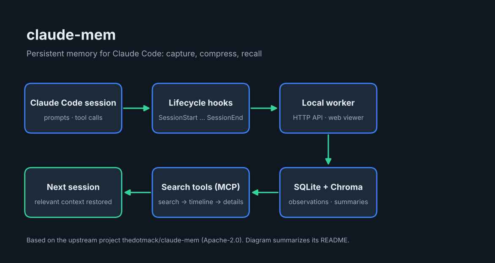

# claude-mem: overview



**claude-mem** adds long-term memory to [Claude Code](https://claude.com/claude-code). It records what happens during your sessions, compresses it into searchable notes, and brings the relevant context back in later sessions, so you do not have to re-explain your project each time.

Upstream project: [thedotmack/claude-mem](https://github.com/thedotmack/claude-mem), license Apache-2.0.

## What it does

1. **Captures** your session through Claude Code lifecycle hooks (`SessionStart`, `UserPromptSubmit`, `PreToolUse`, `PostToolUse`, `Stop`, `SessionEnd`).
2. **Stores** sessions, observations and summaries in a local SQLite database, with a Chroma vector database for semantic plus keyword search.
3. **Serves** them through a local worker (HTTP API and a web viewer).
4. **Recalls** context in new sessions, and lets Claude search memory through MCP tools using a three-step, token-saving pattern: `search` (compact index), `timeline` (context around a result), `get_observations` (full details only for the IDs you pick).

## Requirements

- Node.js 20 or newer
- Claude Code with plugin support
- Bun and uv (the upstream README says they are installed automatically if missing)

## Install

Inside Claude Code:

```
/plugin marketplace add thedotmack/claude-mem
/plugin install claude-mem
```

Or from a terminal:

```bash
npx claude-mem install
```

Restart Claude Code afterwards. Note: `npm install -g claude-mem` installs the SDK/library only; it does not register the plugin hooks.

## Things to know

- The standard installer asks you to sign in in a browser and offers a hosted "observer" with a free trial. The upstream README says you can skip the sign-in by passing an explicit `--provider` flag, setting `CLAUDE_MEM_ONLINE_OPTIN=false`, or running non-interactively. Decide this before you install if you do not want session content processed by a hosted service.
- The upstream README also mentions a community token (CMEM). It is not needed to use the tool.
- Check the upstream documentation at [docs.claude-mem.ai](https://docs.claude-mem.ai) for current commands.

---

Overview prepared by Ashraf Saed | MIGATRONIX. The project itself belongs to its original authors; see its license.

## Automatic install

```bash
git clone https://github.com/AshrafSaed/claude-mem-guide.git
cd claude-mem-guide
bash install.sh
```

Or open this folder in Claude Code and say "install claude-mem": the skill `install-claude-mem` (in `.claude/skills/`) runs the same script.

- Follows upstream README: `npx claude-mem install`. The installer may ask you to sign in via browser; to skip, see the upstream README flags (`--provider`). `npm install -g claude-mem` installs only the SDK, not the plugin.
- After install: Restart Claude Code, then run `/plugin` and confirm claude-mem is listed.
